<div align="center">
  <a href="https://billlens-ph-rccocantos.vercel.app/">
    
  </a>

  <h1>BillLens PH</h1>

  <p>
    <strong>Philippine Hospital Statement Auditor, PhilHealth ACR Verifier &amp; Billing Advocacy Workspace</strong>
  </p>

  <p>
    <a href="https://billlens-ph-rccocantos.vercel.app/"><strong>Live App</strong></a>
    &middot;
    <a href="https://github.com/l4hgs/BillLensPH">Repository</a>
    &middot;
    <a href="#getting-started">Getting Started</a>
    &middot;
    <a href="#key-screens--workflows">Key Screens</a>
  </p>

  <p>
    
    
    
    
    
    
  </p>
</div>

---

## Table of Contents

- [Overview](#overview)
- [Key Screens & Workflows](#key-screens--workflows)
- [Tech Stack](#tech-stack)
- [Project Structure](#project-structure)
- [Getting Started](#getting-started)
- [Official Reference Portals](#official-reference-portals)
- [Data Privacy & Disclaimer](#data-privacy--disclaimer)

---

## Overview

**BillLens PH** translates complex Philippine hospital Itemized Statements of Account (ISAs) and Statements of Account (SOAs) into transparent, line-by-line financial audits.

- **PhilHealth Case Rate Verification:** Cross-references procedures and diagnoses against official **PhilHealth All-Case-Rates (ACR)** benefit caps, including **Circular 2024-0037+** tariff updates and HCI/PF splits.
- **Anti-Unbundling Enforcement:** Flags routine operating room supplies, basic packs, and standard medications that are prohibited from separate out-of-pocket billing when bundled into a claimed case rate.
- **Statutory Discount Sequencing:** Enforces legal deduction order under **RA 9994** (Expanded Senior Citizens Act), **RA 10754** (PWD Act), and **NIRC Sec. 109(G)** (12% VAT exemption followed by 20% discount prior to PhilHealth deduction).
- **A4 Negotiation & Subsidy Briefs:** Generates formal, print-ready hospital billing dispute letters and **Malasakit Center (RA 11463)** assistance briefs.

---

## Key Screens & Workflows

| Screen                 | Route                                                           | Purpose                                                                                                                                                                        |
| :--------------------- | :-------------------------------------------------------------- | :----------------------------------------------------------------------------------------------------------------------------------------------------------------------------- |
| **Home**               | [`/`](https://billlens-ph-rccocantos.vercel.app/)               | Server-hydrated landing overview with an interactive convex magnifying-lens hero and statutory inspection showcase.                                                            |
| **Scan Hub**           | [`/scanner`](https://billlens-ph-rccocantos.vercel.app/scanner) | Camera capture and multi-page dropzone with client-side WebP/JPEG compression, pre-scan PhilHealth/ward parameters, and persistent background OCR/audit progress.              |
| **Document Archive**   | [`/audits`](https://billlens-ph-rccocantos.vercel.app/audits)   | Searchable, time-filtered list of audited statements with total protection savings, thumbnails, and layout-matched skeletons.                                                  |
| **Audit Studio**       | `/audits/[id]`                                                  | Split-screen statement viewer paired with three-tier Traffic-Light categorization, non-destructive line-item overrides, parameter recalculation, and the **Ask Billy** drawer. |
| **Negotiation Brief**  | `/audits/[id]/brief`                                            | Formal A4 portrait printable (`@media print`) dispute and Malasakit Center cover letter with signatory customization and plain-text copy.                                      |
| **PhilHealth Rates**   | [`/rates`](https://billlens-ph-rccocantos.vercel.app/rates)     | Searchable All-Case-Rates directory showing fixed benefit caps, HCI/PF splits, mandatory bundled inclusions, and AI-assisted rate discovery.                                   |
| **AI Chatbot (Billy)** | [`/chatbot`](https://billlens-ph-rccocantos.vercel.app/chatbot) | Full-height (`dvh`-aware) conversational billing navigator grounded in Philippine healthcare rules and optional active statement context.                                      |
| **Profile & Account**  | [`/auth`](https://billlens-ph-rccocantos.vercel.app/auth)       | Single-screen Sign In / Create Account view (Google OAuth & Email) and saved member defaults for contributor category, ward type, MDR/PIN, and facility level.                 |

---

## Tech Stack

| Layer                       | Technologies                                                                                                                                                                 |
| :-------------------------- | :--------------------------------------------------------------------------------------------------------------------------------------------------------------------------- |
| **Framework & Language**    | [Next.js 16.4.6](https://nextjs.org/) (App Router, Turbopack), [React 19.3](https://react.dev/), [TypeScript 5](https://www.typescriptlang.org/)                             |
| **Styling & UI**            | [Tailwind CSS v4](https://tailwindcss.com/), [Lucide React](https://lucide.dev/) (full-width non-bento editorial layout, `44px` tap targets, unified auto-dismissing toasts) |
| **Backend, Auth & Storage** | [Supabase](https://supabase.com/) (PostgreSQL, SSR Cookie Auth, Row-Level Security, private `bill-uploads` bucket)                                                           |
| **AI & Streaming**          | Google Gemini via [Vercel AI SDK](https://sdk.vercel.ai/) (`ai`, `@ai-sdk/google`, `@ai-sdk/react`)                                                                          |
| **Quality & Testing**       | [Vitest 5](https://vitest.dev/), [ESLint 9](https://eslint.org/) (`eslint-config-next`)                                                                                      |

---

## Project Structure

```text
BillLensPH/
├── public/                                 # Brand logos (logo-header.png, logo-wordmark.png), Billy assets & icons
├── supabase/                               # Reproducible SQL migrations & PhilHealth ACR seed data
├── scripts/
│   └── seed-packages.mjs                   # PhilHealth case rate catalog seeding script
└── src/
    ├── app/
    │   ├── (auth)/auth/page.tsx            # Server entry for Sign In / Create Account & Profile defaults
    │   ├── api/
    │   │   ├── audit/ocr/route.ts          # Multimodal Gemini Vision OCR & audit engine endpoint
    │   │   ├── audit/chat/route.ts         # Context-injected Billy streaming chat endpoint
    │   │   ├── rates/route.ts              # Case rate catalog API
    │   │   └── rates/discover/route.ts     # AI case rate discovery endpoint
    │   ├── audits/
    │   │   ├── (list)/                     # Document Archive route & route loading skeleton
    │   │   └── [id]/                       # Audit Studio & printable A4 Negotiation Brief routes
    │   ├── auth/callback/route.ts          # Supabase OAuth PKCE callback handler
    │   ├── chatbot/page.tsx                # Full-screen AI Chatbot ("Billy") view
    │   ├── rates/page.tsx                  # PhilHealth ACR directory & circular manager
    │   ├── scanner/page.tsx                # Scan Hub ingestion & staging controller
    │   ├── globals.css                     # Tailwind CSS v4, print A4 rules & reduced-motion animations
    │   ├── layout.tsx                      # Root layout (Header + MobileContainer + BottomNav + AppProviders)
    │   └── page.tsx                        # Server entry for Home landing view
    ├── components/
    │   ├── audit/                          # AuditLineItemRow, AuditParametersModal, AuditSkeletons,
    │   │                                   # AuditCopilotDrawer, NegotiationBriefDocument, OverrideModal,
    │   │                                   # SideBySideBillViewer, TrafficLight
    │   ├── auth/                           # AuthClient (single-screen auth + profile defaults)
    │   ├── home/                           # HomeClient (interactive convex lens hero & inspection tabs)
    │   ├── layout/                         # Header, BottomNav, MobileContainer
    │   ├── providers/                      # AppProviders, ToastProvider, BackgroundScanToast,
    │   │                                   # ScanBackgroundProvider, ChatbotBackgroundProvider
    │   ├── scanner/                        # ScannerViewfinder, StatementStagingCard
    │   └── ui/                             # button, badge, card, select-menu
    ├── lib/
    │   ├── supabase/                       # Browser, Server, Middleware clients & clockSkewFetch
    │   ├── __tests__/                      # Unit tests (auditEngine.test.ts, chatbotGuardrails.test.ts)
    │   ├── auditEngine.ts                  # PhilHealth ACR matching, unbundling & Senior/PWD engine
    │   ├── auditOverrides.ts               # Non-destructive manual override diffing & recalculation
    │   ├── billingClassification.ts        # Billing line classification helpers
    │   ├── caseRateDiscovery.ts            # AI case rate lookup helpers
    │   ├── chatbotPrompt.ts                # Billy system prompt & Philippine billing guardrails
    │   ├── gemini.ts                       # Gemini Vision extraction & chat helpers
    │   ├── imageCompression.ts             # Client-side canvas downscaler (max 1600px, WebP/JPEG)
    │   ├── itemMatcher.ts                  # ACR inclusion & alias matching
    │   ├── packageCatalog.ts               # Supabase ACR package loader
    │   ├── sampleAudits.ts                 # Built-in hospital ISA fixtures
    │   └── utils.ts                        # PHP currency formatting (formatPHP) & class utilities
    ├── types/
    │   └── audit.ts                        # Shared audit, OCR, eligibility & override TypeScript types
    └── middleware.ts                       # SSR auth session refresh middleware
```

---

## Getting Started

### Prerequisites

- Node.js `>= 20`
- A [Supabase](https://supabase.com/) project with the SQL migrations in `supabase/` applied
- A Google Gemini API key

### Installation & Local Development

1. **Install dependencies:**

   ```bash
   npm install
   ```

2. **Configure environment variables:**

   Copy `.env.local.example` to `.env.local` and supply values for:
   - `NEXT_PUBLIC_SUPABASE_URL`
   - `NEXT_PUBLIC_SUPABASE_ANON_KEY`
   - `GEMINI_API_KEY`

3. **Run the development server:**

   ```bash
   npm run dev
   ```

   Open [http://localhost:3000](http://localhost:3000) in your browser.

4. **Run verification checks:**

   ```bash
   npm run lint
   npm run test
   npx tsc --noEmit
   ```

---

## Official Reference Portals

- [PhilHealth Member Portal](https://memberinquiry.philhealth.gov.ph)
- [Department of Health (DOH)](https://doh.gov.ph)
- [National Commission of Senior Citizens (NCSC)](https://ncsc.gov.ph)

---

## Data Privacy & Disclaimer

BillLens PH is designed in alignment with the **Philippine Data Privacy Act of 2012 (RA 10173)**, with user-isolated Row-Level Security and private statement storage (`bill-uploads`). All audit breakdowns, case-rate estimates, and Billy responses are provided for hospital billing transparency and financial assistance navigation only, and do not constitute formal medical, legal, or official PhilHealth adjudication.
